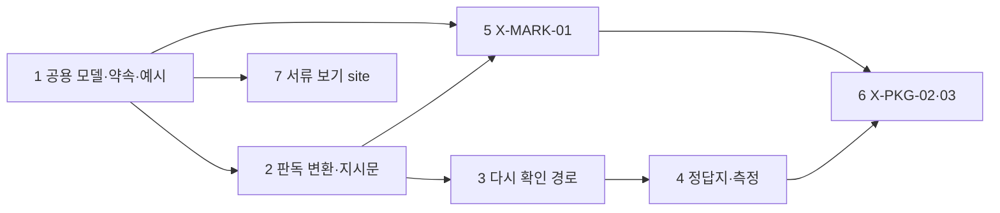

# Implementation Plan: b12-site-fields

> **에이전트 작업자용:** 작업 하나씩 실행한다 (superpowers:executing-plans 또는 subagent-driven-development). 단계는 `- [ ]` 체크박스로 표시한다.
> 작업마다 diff 확인 → 테스트 → 커밋 (`.kiro/specs/README.md`). 자기 담당 이슈의 작업만 한다.

## Overview

**Goal:** 항만 현장이 실물과 맞춰 보는 칸(화인·컨테이너 줄·봉인 번호·규격·품목별 포장 수)을 읽고, 그 칸으로 대조하고, 서류 보기에서 현장 칸을 구분한다. 금액·단가·결제 조건은 지금처럼 읽고 대조한다.

**Architecture:** 공용 모델(`tools/models.py`)에 `ExtractedContainer`·`marks`·`items[].packages`·`SITE_FIELDS`·`ReadField.site`를 더하고, 판독(`to_extracted`)이 raw를 풀어 채운다. 대조는 `validate.py`의 서류 한 장 규칙 함수 셋, 서류 보기는 `handler.read_fields`가 `site`를 붙인다. 모델은 raw만 옮기고 계산·비교는 코드가 한다.

**Tech Stack:** Python 3.13, Pydantic, pytest, uv. 모델 호출은 측정(작업 4)에서만.

**Spec:** `.kiro/specs/b12-site-fields/requirements.md`, `design.md`

## Global Constraints

- 단위 테스트는 AWS·Bedrock을 부르지 않는다. 모델 응답은 가짜 dict로 넣는다.
- Raw 모델 스키마의 선택 속성은 전체 12개 이하 (`_optional_count(...) <= 12`). 새 칸은 필수 + null 허용.
- 기존 칸 이름·뜻은 바꾸지 않는다 (`container_no` 포함). docs/examples가 tools/models.py와 맞아야 한다 (`test_examples.py`).
- `tools/models.py`·`docs/schema.md`·`docs/examples/`는 같은 PR에서 함께 고친다 (CONTRIBUTING.md).
- 모델은 raw만 옮긴다. `value`·`unit`·합계·비교는 코드 (agent-design.md 2·3번).
- 빈 값·칸 누락은 일치로 세지 않는다. 계산으로 확정되는 것만 '불일치'.
- 도구 호출마다 `[tool] 이름 입력` print, 주석·로그·docstring은 한국어.
- 발표용 정답지·서류(eval/test/, samples/test/)는 열지도 다시 쓰지도 않는다.

## Review Focus

1. 화인 줄바꿈이 서류마다 다름 (포장명세서 D001 `EXAMPLE \nDISTRIBUTION KOREA \nINC.` vs B/L `EXAMPLE DISTRIBUTION KOREA\nINC.`): 정규화 뒤 같아서 X-MARK-01이 아무것도 내지 않아야 한다. → 작업 5 `test_화인_줄바꿈과_구두점만_다르면_문제_없음`
2. 양식에 칸이 없음 (스타일 2 포장명세서 화인, 스타일 1 품목별 포장 수): 규칙을 건너뛰고 확인 필요도 내지 않는다. → 작업 5 `test_포장명세서에_화인_칸이_없으면_건너뜀`, 작업 6 `test_품목_포장_수가_모두_칸_없음이면_건너뜀`
3. 컨테이너가 여럿인 B/L (`SMCU8393918 SMCU2669249`): 줄마다 하나씩 옮기고 합으로 비교한다. → 작업 2 `test_컨테이너_줄이_여럿이면_줄마다_푼다`, 작업 6 `test_컨테이너_줄_포장_수_합이_다르면_불일치`
4. 일부 줄만 읽힘 (두 줄 중 하나가 흐림): 합을 내지 않고 확인 필요. → 작업 6 `test_컨테이너_줄_하나가_흐리면_확인_필요`
5. 옛 가짜 응답·옛 판독 캐시 (새 칸 없는 dict): 그대로 검증되고 새 칸은 None·빈 목록. → 작업 1 `test_새_칸_없는_옛_응답도_받는다`

## Tasks

### 이슈 #228 B12: 현장 칸 추가 (공용 파일, 1번 판독) — 브랜치 `chore/228-site-fields`

> 끝남: PR #237 (main `0dfec90`). 리뷰 보완은 `fix/228-site-fields-review`. 계획과 달라진 점은 아래 '작업 1~4 실행 기록'.

#### 작업 1: 공용 모델·약속·예시

**Files:**
- Modify: `tools/models.py` (`ExtractedItem`, `ExtractedDocument`, `RawItem`, `RAW_REQUIRED_NEW`, `RawDocument`, `RawBillOfLading`, `ReadField`), 새 `ExtractedContainer`·`RawContainer`·`SITE_FIELDS`
- Modify: `docs/schema.md` 약속 1 서류 종류별 칸 표·이름 칸 설명, 약속 2 서류 보기 `fields[]`
- Modify: `docs/examples/job_files.json` (B/L 칸 하나에 `site: true`, 송장 금액 칸 하나 `site: false`)
- Test: `tests/unit/test_extract_p1.py`

**Interfaces:**
- Produces:
  - `class ExtractedContainer(_Strict)`: `line: int`, `container_no|seal_no|size_type|packages|gross_kg|cbm: Cell | None = None`
  - `ExtractedDocument.marks: Cell | None = None`, `ExtractedDocument.containers: list[ExtractedContainer] = []`
  - `ExtractedItem.packages: Cell | None = None`
  - `class RawContainer(_Strict)`: `line: int`, 위 여섯 칸 `RawCell | None` (기본값 없음 = 필수)
  - `RawBillOfLading.marks: RawCell | None`, `RawBillOfLading.containers: list[RawContainer]` (필수)
  - `RawDocument.marks: RawCell | None = None` (+ `RAW_REQUIRED_NEW`), `RawItem.packages: RawCell | None = None` (+ 필수 목록)
  - `SITE_FIELDS: dict[str, frozenset[str]]` — 값은 design.md 1번 표 그대로 (품목·컨테이너 칸은 `items.qty`, `containers.seal_no`)
  - `ReadField.site: bool = False`

- [x] **Step 1: 실패하는 테스트 작성**

```python
def test_현장_칸도_선택_속성_한도_안():
    for model in (RawDocument, RawBillOfLading):
        schema = model.model_json_schema()
        assert _optional_count(schema) <= 12          # test_extract.py의 함수를 옮겨 쓰거나 import
    assert "marks" in RawDocument.model_json_schema()["required"]
    assert {"marks", "containers"} <= set(RawBillOfLading.model_json_schema()["required"])

def test_새_칸_없는_옛_응답도_받는다():
    raw = RawDocument.model_validate({"doc_no": {"raw": "X"}, "items": [{"line": 1, "qty": {"raw": "1 PCS"}}]})
    assert raw.marks is None and raw.items[0].packages is None

def test_현장_칸_목록():
    assert "containers.seal_no" in SITE_FIELDS["bill_of_lading"]
    assert "items.packages" in SITE_FIELDS["packing_list"]
    assert "total_amount" not in SITE_FIELDS["commercial_invoice"]   # 관리자만
    assert SITE_FIELDS["certificate_of_origin"] == frozenset()
```

- [x] **Step 2: 실패 확인** — Run: `uv run pytest tests/unit/test_extract_p1.py -k "현장 or 옛_응답" -v` / Expected: FAIL (ImportError `SITE_FIELDS` 또는 AttributeError `marks`)
- [x] **Step 3: 모델 구현** — 위 Interfaces 그대로. 필드 description에 칸 이름·헷갈리는 칸·예시를 적는다: `seal_no` "Seal No. 칸. 컨테이너 번호와 다르다. 예: 'EX1470293'", `size_type` "예: \"20'GP (22G1)\"", `marks` "MARKS & NUMBERS 칸의 줄을 공백 하나로 이은 글자. 예: 'EXAMPLE DISTRIBUTION KOREA INC. BUSAN, KOREA C/NO. 1-53 MADE IN CHINA'", `ExtractedItem.packages` "그 행의 포장 개수(No. of Pkgs, CTNS). 품목 수량(qty)과 다르다. 예: '286'"
- [x] **Step 4: schema.md·예시 고침** — 약속 1 표 B/L 줄에 `marks` `containers[]`(여섯 칸), 포장명세서 줄에 `marks`, 품목 `packages`. "화인은 줄을 공백 하나로 잇는다", "`container_no`는 그대로 두고 `containers[]`는 덧붙인 것" 한 줄씩. 약속 2 서류 보기에 "`site`: 현장 칸이면 true (`SITE_FIELDS`). 관리자는 모든 칸을 본다".
- [x] **Step 5: 통과 확인** — Run: `uv run pytest tests/unit -q` / Expected: 모두 PASS (`test_examples.py` 포함)
- [x] **Step 6: 커밋** — `git commit -m "feat(models): 현장 칸 marks·containers·items.packages와 SITE_FIELDS (B12, 공용)"`

#### 작업 2: 판독 변환과 지시문

**Files:**
- Modify: `tools/extract.py` (`_cell`, `_DOC_KINDS`, `_ITEM_KINDS`, 새 `_CONTAINER_KINDS`, `to_extracted`, `_DOC_RULES`)
- Test: `tests/unit/test_extract_p1.py`

**Interfaces:**
- Consumes: 작업 1의 `RawContainer`, `ExtractedContainer`, `marks`, `packages`
- Produces: `to_extracted(raw_doc, doc_type, file) -> ExtractedDocument` (시그니처 그대로)가 `containers`·`marks`·`items[].packages`를 채운다

- [x] **Step 1: 실패하는 테스트 작성** (`BL` dict에 `"marks"`, `"containers"`를 더한 `BL_SITE`를 만든다)

```python
BL_SITE = {**BL, "marks": cell("EXAMPLE HOME LIVING\nBUSAN, KOREA C/NO. 1-535"),
           "containers": [
               {"line": 1, "container_no": cell("SMCU8393918"), "seal_no": cell("SM1470293"), "size_type": cell("40'HC (45G1)"),
                "packages": cell("300 CTNS"), "gross_kg": cell("4,400.000 KGS"), "cbm": cell("35.000 CBM")},
               {"line": 2, "container_no": cell("SMCU2669249"), "seal_no": cell("SM1470294"), "size_type": cell("40'HC (45G1)"),
                "packages": cell("235 CTNS"), "gross_kg": cell("3,514.600 KGS"), "cbm": cell("28.610 CBM")}]}

def test_컨테이너_줄이_여럿이면_줄마다_푼다():
    doc = to_extracted(RawBillOfLading.model_validate(BL_SITE), "bill_of_lading", "bl.pdf")
    assert [c.line for c in doc.containers] == [1, 2]
    c = doc.containers[1]
    assert (c.seal_no.value, c.packages.value, c.packages.unit, c.gross_kg.value, c.cbm.value) == ("SM1470294", 235, "CTN", 3514.6, 28.61)
    assert doc.container_no.raw == "SMCU8393918 SMCU2669249"   # 기존 칸 그대로

def test_화인은_대문자_공백_하나로_푼다():
    doc = to_extracted(RawBillOfLading.model_validate(BL_SITE), "bill_of_lading", "bl.pdf")
    assert doc.marks.raw == "EXAMPLE HOME LIVING\nBUSAN, KOREA C/NO. 1-535"
    assert doc.marks.value == "EXAMPLE HOME LIVING BUSAN, KOREA C/NO. 1-535"

def test_포장명세서_품목별_포장_수():
    raw = {**PL, "items": [{**PL["items"][0], "packages": cell("286")}]}
    doc = to_extracted(RawDocument.model_validate(raw), "packing_list", "pl.pdf")
    assert doc.items[0].packages.value == 286

def test_지시문에_현장_칸_설명이_있다():
    assert "CONTAINER DETAILS" in system_prompt("bill_of_lading") and "봉인 번호" in system_prompt("bill_of_lading")
    assert "packages" in system_prompt("packing_list")
```

- [x] **Step 2: 실패 확인** — Run: `uv run pytest tests/unit/test_extract_p1.py -k "컨테이너_줄 or 화인 or 품목별_포장 or 지시문에_현장" -v` / Expected: FAIL
- [x] **Step 3: 구현** — `_cell` 종류 `"marks"`: `Cell(raw=raw, value=" ".join(raw.upper().split()))`. `_CONTAINER_KINDS`·`_DOC_KINDS["marks"]`·`_ITEM_KINDS["packages"]="qty"`는 design.md 2번 값. `to_extracted`는 `containers`를 `items`처럼 줄마다 바꾸고, `cells`를 만들 때 `items`·`containers`를 뺀다. `_DOC_RULES` 문장은 design.md 2번 그대로.
- [x] **Step 4: 통과 확인** — Run: `uv run pytest tests/unit/test_extract.py tests/unit/test_extract_p1.py tests/unit/test_read_cache.py -q` / Expected: PASS
- [x] **Step 5: 커밋** — `git commit -m "feat(extract): 화인·컨테이너 줄·품목별 포장 수 풀기와 지시문 (B12)"`

#### 작업 3: 다시 확인 경로에 컨테이너 줄

**Files:**
- Modify: `tools/reread.py` (`_PATH`, `field_raw`)
- Test: `tests/unit/test_reread.py`

**Interfaces:**
- Produces: `field_raw(doc, field)`가 `containers[0].seal_no`, `containers[*].packages`(줄 raw를 `' + '`로 이음)를 받는다. 모르는 경로는 지금처럼 `ValueError`.

- [x] **Step 1: 실패하는 테스트 작성**

```python
def test_field_raw_컨테이너_경로():
    doc = to_extracted(RawBillOfLading.model_validate(BL_SITE), "bill_of_lading", "bl.pdf")  # 작업 2의 dict를 여기에도 둔다
    assert field_raw(doc, "containers[1].seal_no") == "SM1470294"
    assert field_raw(doc, "containers[*].packages") == "300 CTNS + 235 CTNS"
    assert field_raw(doc, "containers[5].seal_no") is None
    assert field_raw(doc, "marks") == "EXAMPLE HOME LIVING\nBUSAN, KOREA C/NO. 1-535"
    with pytest.raises(ValueError):
        field_raw(doc, "boxes[0].seal_no")
```

- [x] **Step 2: 실패 확인** — Run: `uv run pytest tests/unit/test_reread.py -k 컨테이너_경로 -v` / Expected: FAIL (`ValueError: 모르는 칸 경로`)
- [x] **Step 3: 구현** — `_PATH = re.compile(r"^(?:(items|containers)\[(\d+|\*)\]\.)?([a-z_]+)$")`, 목록 이름으로 `getattr(doc, list_name, [])`를 읽는다.
- [x] **Step 4: 통과 확인** — Run: `uv run pytest tests/unit/test_reread.py -q` / Expected: PASS
- [x] **Step 5: 커밋** — `git commit -m "feat(reread): 컨테이너 줄 칸 경로 (B12)"`

#### 작업 4: 정답지와 판독 측정

**Files:**
- Modify: `samples/build_samples.py` (fields.csv 줄 추가), `samples/check_samples.py` (`--docs` 확인 칸), `samples/measure_read_all.py` (경로·맞춤 기준)
- Modify: `eval/fields.csv` (개발용만, build_samples가 다시 씀)

**Interfaces:**
- Consumes: 작업 2의 `ExtractedDocument.containers`·`marks`·`items[].packages`
- Produces: `eval/fields.csv` 새 칸 이름 `marks`, `containers[i].container_no|seal_no|size_type|packages`, `items[i].packages`

- [x] **Step 1: 정답 쓰기** — build_samples가 B/L 정답에 `marks`(줄을 공백 하나로 이음)와 `conts` 줄마다 `containers[i].*`, 포장명세서 스타일 1에 `marks`, 스타일 2에 `items[i].packages`를 쓴다. 서류는 다시 그리지 않는다 (실행 기록 3 참고).
- [x] **Step 2: 찍혔는지 확인** — Run: `uv run python samples/check_samples.py --docs --only D001 D008 D011` / Expected: 새 칸 정답이 서류 글자에 있음, 실패 0
- [x] **Step 3: 측정 맞춤 기준** — `measure_read_all.same`: `marks`는 대문자·`[^A-Z0-9]` 제거 뒤 같으면 맞음, `containers[i].*`는 `items[i].*`처럼 경로로 찾는다.
- [x] **Step 4: 측정 (모델 호출, 수동)** — Run: `NO_CACHE=1 MODEL_ID=... uv run python -m samples.measure_read_all --only D001 D002 D003 D004 D005 D006 D007 D008 D009 D010 D011 D013 --out tmp/read_site_dev.jsonl` / Expected: 새 칸 칸별 정답 수가 나오고, P0 칸(송장·포장명세서 invoice_no·total_qty·total_gross_kg)은 72/72 그대로. 결과를 PR 본문과 design.md 5번에 적는다.
- [x] **Step 5: 커밋** — `git commit -m "feat(samples): 현장 칸 정답지와 판독 측정 (B12)"`

#### 작업 1~4 실행 기록

1. `RawBillOfLading.marks`·`containers`에 파이썬 기본값을 두고 스키마에서만 필수로 했다. 기존 B/L 가짜 응답이 깨져서. 대가: 모델이 칸을 빠뜨려도 파이썬 검증은 통과 (Bedrock 구조화 출력은 스키마가 필수라 드묾).
2. 작업 1 커밋에 `to_extracted` 최소 수정(packages 종류, containers 제외)을 넣었다. 모델만 바꾸면 테스트 37개가 깨져서.
3. LibreOffice·poppler가 없어 build_samples 전체를 못 돌렸다. 같은 함수(`bl_data`, 새 `pl_site_fields`)로 fields.csv에 607줄만 더했고, 텍스트 PDF 347칸은 글자층에서 모두 찾았다. 스캔·PNG 260칸은 `check_samples --docs`로 확인 못 함 (1번에게 요청).
4. 포장명세서에 심은 오류·변형이 있는 세트는 포장명세서 새 칸 정답을 쓰지 않았다 (양식이 고친 값으로 박스 수를 다시 계산). 그래서 화인 26, 포장 수 46칸뿐이다.
5. `check_samples.py`는 고치지 않았다. `found()`가 새 칸을 이미 일반 규칙으로 찾는다.
6. 측정(Step 4)은 사용자가 돌렸다: 45장 474/475, 새 칸 전부 정답, P0 72/72 (design.md Testing Strategy).
7. 합친 뒤 리뷰 보완 (`fix/228-site-fields-review`): `same_value`가 packages·cbm을 글자로 비교하던 것을 숫자·단위 비교로, 예시 `job_files.json`의 `site`를 `SITE_FIELDS`와 맞추고 계약 테스트 추가.

### 이슈 #229 B13: 현장 칸 대조 규칙 (2번 검증) — B12가 합쳐진 뒤, 브랜치 `feat/b13-site-rules`

#### 작업 5: X-MARK-01 화인 대조

**Files:**
- Modify: `tools/rules/rules.csv` (X-MARK-01 확인 필요 줄, 출처는 2번이 조사), `tools/validate.py` (새 `_check_marks`, `_SINGLE_DOC_RULES`)
- Test: `tests/unit/test_validate_p1.py`

**Interfaces:**
- Consumes: `ExtractedDocument.marks` (작업 1)
- Produces: `cross_check`가 `Issue(rule_id="X-MARK-01", grade="확인 필요", cells=[IssueCell(doc="bill_of_lading", field="marks", ...), IssueCell(doc="packing_list", field="marks", ...)])`를 낸다

- [ ] **Step 1: 실패하는 테스트 작성** (파일의 `doc`, `no_cell`, `only` 도우미를 쓴다)

```python
def marks(text):
    return Cell(raw=text, value=" ".join(text.upper().split()))

def test_화인_줄바꿈과_구두점만_다르면_문제_없음():
    docs = [doc("bill_of_lading", marks=marks("EXAMPLE DISTRIBUTION KOREA\nINC.\nBUSAN, KOREA\nC/NO. 1-53")),
            doc("packing_list", marks=marks("EXAMPLE \nDISTRIBUTION KOREA \nINC.\nBUSAN,KOREA\nC/NO.1-53"))]
    assert only(docs, "X-MARK-01") == []

def test_화인이_다르면_확인_필요와_두_칸():
    docs = [doc("bill_of_lading", marks=marks("EXAMPLE BUSAN C/NO. 1-53")), doc("packing_list", marks=marks("EXAMPLE BUSAN C/NO. 1-35"))]
    [issue] = only(docs, "X-MARK-01")
    assert issue.grade == "확인 필요" and {c.doc for c in issue.cells} == {"bill_of_lading", "packing_list"}

def test_포장명세서에_화인_칸이_없으면_건너뜀():
    docs = [doc("bill_of_lading", marks=marks("EXAMPLE")), doc("packing_list", marks=no_cell("칸 없음"))]
    assert only(docs, "X-MARK-01") == []

def test_화인이_흐리면_확인_필요():
    docs = [doc("bill_of_lading", marks=marks("EXAMPLE")), doc("packing_list", marks=no_cell("흐림"))]
    assert [i.grade for i in only(docs, "X-MARK-01")] == ["확인 필요"]
```

- [ ] **Step 2: 실패 확인** — Run: `uv run pytest tests/unit/test_validate_p1.py -k 화인 -v` / Expected: FAIL
- [ ] **Step 3: 구현** — `_check_marks(docs: list[ExtractedDocument]) -> list[Issue]`: B/L·포장명세서가 둘 다 있을 때만, `_is_absent`면 건너뜀, 정규화 `re.sub(r"[^A-Z0-9]", "", text.upper())`. 근거 문장은 rules.csv 문장틀.
- [ ] **Step 4: 통과 확인** — Run: `uv run pytest tests/unit/test_validate.py tests/unit/test_validate_p1.py -q` / Expected: PASS
- [ ] **Step 5: 커밋** — `git commit -m "feat(validate): X-MARK-01 선하증권·포장명세서 화인 대조 (B13)"`

#### 작업 6: X-PKG-02·X-PKG-03 포장 수 합계

**Files:**
- Modify: `tools/rules/rules.csv` (두 규칙의 불일치·확인 필요 줄), `tools/validate.py` (새 `_check_container_packages`, `_check_item_packages`), `eval/score.py` (`oracle_docs`)
- Test 파일은 `ExtractedContainer`도 import 한다 (`from tools.models import Cell, ExtractedContainer, ExtractedDocument, ExtractedItem`).
- Test: `tests/unit/test_validate_p1.py`

**Interfaces:**
- Consumes: `ExtractedDocument.containers`, `ExtractedItem.packages`, `total_packages` (작업 1)
- Produces: X-PKG-02 cells `[IssueCell(field="containers[*].packages"), IssueCell(field="total_packages")]` (bill_of_lading), X-PKG-03 cells `[IssueCell(field="items[*].packages"), IssueCell(field="total_packages")]` (packing_list). raw는 `field_raw`와 같은 모양

- [ ] **Step 1: 실패하는 테스트 작성**

```python
def cont(line, n):
    return ExtractedContainer(line=line, packages=Cell(raw=f"{n} CTNS", value=n, unit="CTN"))

def test_컨테이너_줄_포장_수_합이_다르면_불일치():
    d = doc("bill_of_lading", total_packages=pkgs(535), containers=[cont(1, 300), cont(2, 230)])
    [issue] = only([d], "X-PKG-02")
    assert issue.grade == "불일치" and "530" in issue.evidence and "535" in issue.evidence

def test_컨테이너_줄_포장_수_합이_같으면_문제_없음():
    assert only([doc("bill_of_lading", total_packages=pkgs(535), containers=[cont(1, 300), cont(2, 235)])], "X-PKG-02") == []

def test_컨테이너_줄_하나가_흐리면_확인_필요():
    blurred = ExtractedContainer(line=2, packages=no_cell("흐림"))
    d = doc("bill_of_lading", total_packages=pkgs(535), containers=[cont(1, 300), blurred])
    assert [i.grade for i in only([d], "X-PKG-02")] == ["확인 필요"]

def test_컨테이너_줄이_없으면_건너뜀():
    assert only([doc("bill_of_lading", total_packages=pkgs(535))], "X-PKG-02") == []

def test_품목_포장_수_합이_다르면_불일치():
    items = [ExtractedItem(line=1, packages=pkgs(286)), ExtractedItem(line=2, packages=pkgs(370))]
    [issue] = only([doc("packing_list", total_packages=pkgs(660), items=items)], "X-PKG-03")
    assert issue.grade == "불일치"

def test_품목_포장_수가_모두_칸_없음이면_건너뜀():
    items = [ExtractedItem(line=1, packages=no_cell("칸 없음"))]
    assert only([doc("packing_list", total_packages=pkgs(53), items=items)], "X-PKG-03") == []
```

- [ ] **Step 2: 실패 확인** — Run: `uv run pytest tests/unit/test_validate_p1.py -k "포장_수" -v` / Expected: FAIL
- [ ] **Step 3: 구현** — `_check_container_packages(docs)`, `_check_item_packages(docs)`: 허용 오차 0, 합은 `_fmt`로 근거 문장에 넣는다. 건너뜀·확인 필요 조건은 design.md 3번.
- [ ] **Step 4: 정답 값으로 다시 채점 (모델 호출 없음)** — `eval/score.py`의 `oracle_docs`가 fields.csv의 새 칸(`marks`, `containers[i].*`, `items[i].packages`, 작업 4에서 이미 들어감)도 채우게 한다. 지금은 모르는 칸을 무시해서 채점 숫자가 안 바뀐다 (작업 4 전후 같음: 53건 중 43건, 오탐 0/30). Run: `uv run python -m eval.score --split dev --p1` / Expected: 정상 세트 오탐 0건, 기존 규칙 탐지 수는 이 작업 전과 같음 (먼저 한 번 돌려 숫자를 적어 둔다).
- [ ] **Step 5: 통과 확인·커밋** — Run: `uv run pytest tests/unit -q` / Expected: PASS. `git commit -m "feat(validate): X-PKG-02·X-PKG-03 포장 수 합계 대조 (B13)"`

### 이슈 #230 F12: 서류 보기에 현장 칸 표시 (4번 서버) — B12가 합쳐진 뒤, 브랜치 `feat/f12-site-view`

#### 작업 7: read_fields의 컨테이너 줄과 site

**Files:**
- Modify: `api/handler.py` (`_LABELS`, `read_fields`, 새 `_is_site`)
- Test: `tests/unit/test_handler.py`

**Interfaces:**
- Consumes: `SITE_FIELDS`, `ReadField.site`, `ExtractedDocument.containers` (작업 1)
- Produces: `read_fields(doc) -> list[ReadField]` (시그니처 그대로), `_is_site(doc_type: str, path: str) -> bool`

- [ ] **Step 1: 실패하는 테스트 작성**

```python
def test_read_fields_컨테이너_줄과_현장_표시():
    doc = ExtractedDocument(doc_type="bill_of_lading", file="bl.pdf",
                            total_packages=Cell(raw="53 CARTONS", value=53, unit="CTN"),
                            containers=[ExtractedContainer(line=1, seal_no=Cell(raw="EX1470293", value="EX1470293"))])
    by = {f.field: f for f in handler.read_fields(doc)}
    assert by["containers[0].seal_no"].label == "1번 컨테이너 봉인 번호" and by["containers[0].seal_no"].site is True
    assert by["total_packages"].site is True

def test_금액_칸은_현장_칸이_아니지만_보인다():
    doc = ExtractedDocument(doc_type="commercial_invoice", file="ci.pdf", total_amount=Cell(raw="USD 1.00", value=1.0, unit="USD"))
    [f] = handler.read_fields(doc)
    assert f.field == "total_amount" and f.site is False
```

- [ ] **Step 2: 실패 확인** — Run: `uv run pytest tests/unit/test_handler.py -k "현장" -v` / Expected: FAIL
- [ ] **Step 3: 구현** — `_LABELS` 추가는 design.md 4번. `_is_site`: `re.sub(r"\[\d+\]", "", path) in SITE_FIELDS.get(doc_type, frozenset())`. 컨테이너 줄은 `f"containers[{i}].{name}"`, 이름 `f"{c.line}번 컨테이너 {라벨}"`.
- [ ] **Step 4: 통과 확인** — Run: `uv run pytest tests/unit/test_handler.py tests/unit/test_examples.py -q` / Expected: PASS
- [ ] **Step 5: 커밋** — `git commit -m "feat(api): 서류 보기에 컨테이너 줄과 현장 칸 표시 (F12)"`

## Task Dependency Graph



- 작업 1~4 = 이슈 B12 (PR 하나). 작업 5~6 = 이슈 B13, 작업 7 = 이슈 F12. B13·F12는 B12가 main에 합쳐진 뒤 최신 main에서 시작한다.
- 작업 6의 다시 채점은 작업 4의 정답지(fields.csv 새 칸)가 있어야 한다.

## Notes

나중 (이번 이슈에서 코드로 만들지 않는다):
1. 화면의 현장 보기 (`site`로 거르기, 3번).
2. 가상 WMS 입고 예정에 화인·컨테이너·봉인 번호 넣기 (`push_to_wms`, 4번).
3. 줄별 박스 번호 범위(`carton_range`): 그런 양식이 데이터셋에 생기면.
4. 위험물(UN 번호·등급)·냉동 설정 온도, 서류에 없는 현장 정보(수리 여부·D/O·장치 위치): 외부 연동 (P2).
5. 발표용 정답지에 새 칸 넣기: 잠금(samples/test_lock.json) 처리와 함께 PM이 정한다.
