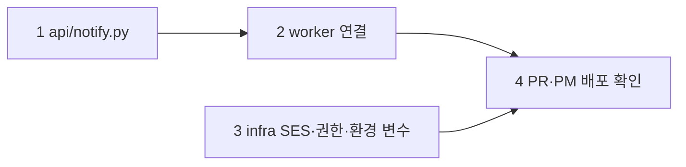

# Implementation Plan

> 작업 하나씩 실행하고 diff 확인 → 테스트 → 커밋 (.kiro/specs/README.md). 체크박스(`- [ ]`)로 진행을 표시한다.

## Overview

**목표:** 불일치나 HS 미확정이 남은 작업이 끝나면, 처리 Lambda가 해당 문서를 첨부해 담당자에게 SES로 확인 요청 메일을 보낸다.

**구조:** 새 모듈 `api/notify.py`가 보낼 것 고르기·첨부·메일 만들기·SES 호출을 맡고, `api/worker.py`가 마지막 저장 직전에 한 번 부른다.
SES 이메일 ID·권한·환경 변수는 `infra/`(PR, PM 실행)로 만든다.

**기술:** Python 3.13, 표준 라이브러리 `email`, boto3 `sesv2`, pytest. 새 의존성 없음.

**Spec:** `requirements.md`, `design.md` (같은 폴더)

## 전체 제약

- 단위 테스트는 AWS를 부르지 않는다. SES는 가짜 `MailSender`로 대신한다.
- 메일 주소를 저장소에 적지 않는다. 테스트 주소는 `notice@example.com`(보내는 쪽), `owner@example.com`(받는 쪽)만 쓴다.
- SES 호출은 연결·읽기 타임아웃 5초, `retries={"max_attempts": 2}`, 리전 ap-northeast-2.
- 제목·헤더에는 코드 값(작업 ID, 건수)만 넣는다. 서류 글자는 본문에만, 한 줄·80자 상한.
- 주석·로그·docstring은 한국어. 도구를 부를 때 `[tool] send_notice job=… 불일치=N HS미확정=M`을 print한다. 주소는 찍지 않는다.
- 고치는 곳: `api/`, `tests/unit/test_notify.py`, `tests/unit/test_worker.py`(4번), `infra/`(PR만, 실행은 PM).
  `tools/validate.py`(2번), `tools/hs_request.py`(PM)는 부르기만 한다.

## 리뷰에서 볼 것

1. 서류 B/L 번호에 `\r\nBcc: evil@example.com` 같은 글자가 있으면 → 헤더가 늘지 않고 본문에 한 줄로만 들어간다 (작업 1 `test_header_injection_is_ignored`).
2. 자동 등록이 WMS 오류로 실패해 `waiting_approval`이 된 작업(문제·HS 미확정 없음) → 메일을 보내지 않는다 (작업 1 `test_targets_none_when_only_check_or_not_waiting`).
3. 받는 주소가 SES에서 아직 인증되지 않아 `MessageRejected` → 단계 `ok=false`, 작업은 승인 대기로 저장된다 (작업 1 `test_ses_failure_returns_failed_step`, 작업 2 `test_worker_mail_failure_keeps_waiting_job`).
4. HS 확인 요청서 만들기가 예외를 내면 → 메일을 보내지 않고 단계 `ok=false` (작업 1 `test_attachment_failure_sends_nothing`).
5. Lambda가 같은 이벤트를 다시 보내면(`running` 상태) → 메일이 다시 가지 않는다 (작업 2 `test_worker_retry_sends_no_mail`).

## Task Dependency Graph



- 작업 1~4 = 이슈 F13 (PR 하나). 작업 3은 1·2와 독립이라 먼저 해도 된다.

## Tasks

### 작업 1: `api/notify.py` 메일 만들기와 보내기 (4번)

**파일:**
- 만들기: `api/notify.py`
- 만들기(시험): `tests/unit/test_notify.py`

**주고받는 것:**
- 쓰는 것: `tools.validate.notice_document(job_id, docs, issues) -> NoticeDocument`, `tools.hs_request.pending_hs(job) -> list[HSResult]`,
  `tools.hs_request.make_hs_request(job, docs, *, importer=None, now=None) -> bytes`, `api.handler._notice_name(subject, job_id, ext) -> str`.
  시험이 바꿔 끼울 수 있게 모듈로 가져와 부른다 (`from tools import hs_request, validate`).
- 내는 것 (작업 2가 쓴다): `send_notice(job: Job, docs: list[ExtractedDocument], importer: str | None, *, mail: MailSender | None = None, env: Mapping[str, str] | None = None, now: datetime | None = None) -> Step | None`, `ses_sender() -> MailSender`, `NOTIFY_TOOL = "send_notice"`.

- [ ] **1. 실패하는 시험 쓰기** (`tests/unit/test_notify.py`)

  준비물: `tests.unit.test_hs_request`의 `docs`, `pending`, `IMPORTER`, `BL`, `NOW`를 가져다 쓴다. `JOB = "job-0000f013"`.
  `MISMATCH = Issue(rule_id="X-WT-01", grade="불일치", cells=[IssueCell(doc="packing_list", field="total_gross_kg", raw="6,520 KGS")], evidence="상업송장 총중량 6,250kg과 포장명세서 6,520kg이 다릅니다.")`,
  `CHECK = Issue(rule_id="X-QT-02", grade="확인 필요", cells=[], evidence="총수량을 읽지 못했습니다.")`.
  `ENV = {"NOTIFY_FROM": "notice@example.com", "NOTIFY_TO": "owner@example.com"}`.
  `FakeMail`: `send(sender, to, raw)`를 `calls`에 쌓고 `"msg-1"`을 돌려준다. `error`를 주면 그 예외를 낸다.
  메일은 `email.message_from_bytes(raw, policy=email.policy.default)`로 읽고, 첨부는 `iter_attachments()`로 본다.

  ```python
  def test_targets_mismatch_and_pending():
      job = job_of(issues=[MISMATCH, CHECK], hs=[pending()])
      assert notify.notice_targets(job) == ([MISMATCH], [pending()])

  def test_targets_none_when_only_check_or_not_waiting():
      assert notify.notice_targets(job_of(issues=[CHECK])) == ([], [])
      assert notify.notice_targets(job_of(status="done", issues=[MISMATCH])) == ([], [])

  def test_mismatch_only_attaches_notice_html():   # 첨부 이름 [f"notice-{BL}.html"], 형식 text/html, 내용에 "X-WT-01"
  def test_pending_only_attaches_pdf():            # 첨부 이름 [f"hs-request-{JOB}.pdf"], 형식 application/pdf, 내용이 b"%PDF"로 시작
  def test_both_one_mail_two_attachments():
      # len(mail.calls) == 1, 첨부 이름 [f"notice-{BL}.html", f"hs-request-{JOB}.pdf"]
      assert step == Step(tool="send_notice", summary="담당자에게 확인 요청 메일 보냄 (불일치 1건 · HS 미확정 1개, 첨부 2개)", ok=True)
      assert mail.calls[0][:2] == ("notice@example.com", "owner@example.com")

  def test_subject_uses_code_values_only():
      assert msg["Subject"] == f"[확인 요청] 작업 {JOB} · 불일치 1건 · HS 미확정 1개"   # 둘 다
      assert msg2["Subject"] == f"[확인 요청] 작업 {JOB} · 불일치 1건"                    # 불일치만

  def test_header_injection_is_ignored():
      # B/L raw = "BL-1\r\nBcc: evil@example.com"
      assert msg["Bcc"] is None and msg["Subject"] == f"[확인 요청] 작업 {JOB} · 불일치 1건"
      assert "B/L 번호: BL-1 Bcc: evil@example.com" in body   # 한 줄로 정리된 데이터

  def test_body_lists_values_and_review_note():
      # 본문에 "자동 생성 메일입니다. 첨부 문서를 검토한 뒤 관세사·거래처에 전달하세요.", JOB, BL, "QDT/26/0289",
      # "X-WT-01", "1행 WOODEN DINING CHAIR, OAK FRAME", 두 첨부 이름

  def test_long_document_text_is_cut():
      # 품명 "A" * 200 → "A" * 80 은 본문에 있고 "A" * 81 은 없다

  def test_no_config_sends_nothing():
      assert notify.send_notice(job, docs(), IMPORTER, mail=mail, env={}) is None
      assert notify.send_notice(job, docs(), IMPORTER, mail=mail, env={"NOTIFY_FROM": "notice@example.com"}) is None
      assert mail.calls == []

  def test_nothing_to_send_returns_none():          # CHECK만 → None, mail.calls == []
  def test_ses_failure_returns_failed_step():
      # FakeMail(error=fakes._client_error("SendEmail"))
      assert step.ok is False and step.tool == "send_notice" and "ClientError" in step.summary and "@" not in step.summary

  def test_attachment_failure_sends_nothing(monkeypatch):
      # monkeypatch.setattr(hs_request, "make_hs_request", 예외 ValueError)
      assert step.ok is False and "첨부를 만들지 못함" in step.summary and mail.calls == []

  def test_ses_sender_config(monkeypatch):
      # boto3.client를 가짜로 바꿔 받은 인자를 본다
      assert service == "sesv2" and kwargs["region_name"] == "ap-northeast-2"
      assert (cfg.connect_timeout, cfg.read_timeout, cfg.retries) == (5, 5, {"max_attempts": 2})
      # sender.send("notice@example.com", "owner@example.com", b"raw") == "msg-1" 이고
      # send_email(FromEmailAddress="notice@example.com", Destination={"ToAddresses": ["owner@example.com"]}, Content={"Raw": {"Data": b"raw"}})
  ```

- [ ] **2. 시험이 실패하는지 확인**
  실행: `uv run pytest tests/unit/test_notify.py -q`
  기대: `ModuleNotFoundError: No module named 'api.notify'`

- [ ] **3. `api/notify.py` 만들기**
  - `notice_targets(job: Job) -> tuple[list[Issue], list[HSResult]]`
  - `build_attachments(job: Job, docs: list[ExtractedDocument], importer: str | None, *, now: datetime | None = None) -> list[tuple[str, str, bytes]]`
    (파일 이름, MIME 형식, 바이트). HTML은 `text/html`, PDF는 `application/pdf`.
  - `build_message(job, docs, importer, *, sender: str, to: str, now: datetime | None = None) -> EmailMessage`
    본문 문장은 requirements 2.4 그대로. 서류 글자는 `_one_line(text: str | None, limit: int = 80) -> str`(제어 문자·줄바꿈 → 공백, 공백 하나, 없으면 '없음').
    B/L 번호·송장 번호는 `hs_request`처럼 선하증권·상업송장의 첫 `doc_no` raw를 쓴다.
  - `class MailSender(Protocol)`: `send(self, sender: str, to: str, raw: bytes) -> str`
  - `ses_sender() -> MailSender`: 리전은 `os.environ.get("AWS_REGION", "ap-northeast-2")`.
  - `send_notice(...)`: 설계의 순서대로 None / 첨부 실패 / SES 실패 / 성공. 예외를 올리지 않는다. `env`가 None이면 `os.environ`, `mail`이 None이면 `ses_sender()`.
  - docstring에 언제·받는 것·반환을 한국어로 적는다.

- [ ] **4. 시험 통과 확인**
  실행: `uv run pytest tests/unit/test_notify.py -q` → 모두 통과
  실행: `uv run pytest -q` → 기존 시험도 통과

- [ ] **5. 커밋**
  ```bash
  git add api/notify.py tests/unit/test_notify.py
  git commit -m "feat(api): F13 확인 요청 메일 만들기와 SES 보내기 (api/notify.py)"
  ```

### 작업 2: 처리 Lambda에서 메일 보내기 (4번, 작업 1 뒤)

**파일:**
- 고치기: `api/worker.py` (`lambda_handler`의 `_mark_waiting(result)` 뒤, 모듈 docstring 환경 변수 목록)
- 고치기(시험): `tests/unit/test_worker.py`

**주고받는 것:**
- 쓰는 것: 작업 1의 `notify.send_notice`, `notify.ses_sender`, 이 파일의 `importer_of(docs)`.
- 내는 것: 마지막 저장의 단계 기록 끝에 `send_notice` 한 줄 (보냈거나 실패했을 때만).

- [ ] **1. 실패하는 시험 쓰기** (`tests/unit/test_worker.py`)

  준비물: 기존 `table`, `put_job`, `saved` 픽스처와 `tests.unit.test_notify`의 `FakeMail`, `MISMATCH`, `DOCS = docs()`(test_hs_request). `monkeypatch.setenv("NOTIFY_FROM", "notice@example.com")`, `monkeypatch.setenv("NOTIFY_TO", "owner@example.com")`,
  `monkeypatch.setattr(notify, "ses_sender", lambda: mail)`. 가짜 `run_job`은 `on_docs(DOCS)`를 부르고 `Job(status="waiting_approval", result=JobResult(issues=[MISMATCH]))`를 돌려준다.

  ```python
  def test_worker_sends_notice_for_mismatch(table, monkeypatch):
      assert len(mail.calls) == 1
      assert saved(table).status == "waiting_approval"
      assert saved(table).steps[-1].tool == "send_notice" and saved(table).steps[-1].ok

  def test_worker_mail_failure_keeps_waiting_job(table, monkeypatch):   # mail이 예외를 냄
      assert saved(table).status == "waiting_approval" and saved(table).steps[-1].ok is False

  def test_worker_done_sends_no_mail(table, monkeypatch):               # run_job이 done, 서류 없음
      assert mail.calls == [] and all(s.tool != "send_notice" for s in saved(table).steps)

  def test_worker_retry_sends_no_mail(table, monkeypatch):              # put_job(table, status="running")
      assert worker.lambda_handler({"job_id": JOB, "files": FILES}, None)["status"] == "failed"
      assert mail.calls == []
  ```

- [ ] **2. 시험이 실패하는지 확인**
  실행: `uv run pytest tests/unit/test_worker.py -q -k "notice or mail"`
  기대: `test_worker_sends_notice_for_mismatch`, `test_worker_mail_failure_keeps_waiting_job` 실패 (메일을 부르지 않음)

- [ ] **3. `api/worker.py` 고치기**
  `from api import handler, notify`. 설계의 세 줄을 `_mark_waiting(result)` 바로 뒤에 넣는다. 모듈 docstring 환경 변수 목록에 `NOTIFY_FROM`, `NOTIFY_TO`(선택)를,
  처리 순서 설명에 "4. 불일치·HS 미확정이 남은 승인 대기면 담당자에게 확인 요청 메일 (F13)"을 더한다.

- [ ] **4. 시험 통과 확인**
  실행: `uv run pytest -q` → 모두 통과

- [ ] **5. 커밋**
  ```bash
  git add api/worker.py tests/unit/test_worker.py
  git commit -m "feat(worker): F13 승인 대기로 끝난 작업에 확인 요청 메일"
  ```

### 작업 3: SES 이메일 ID·권한·환경 변수 (4번이 PR, PM이 실행)

**파일:**
- 만들기: `infra/policy-notify.json`
- 고치기: `infra/create.sh`, `infra/README.md`

**주고받는 것:**
- 쓰는 것: `config.sh`의 `render`, `ROLE_WORKER`, `FN_WORKER`, `WORKER_ENV`.
- 내는 것: worker 환경 변수 `NOTIFY_FROM`, `NOTIFY_TO` (작업 1·2가 읽는다), 정책 `team06-notify`.

- [ ] **1. `infra/policy-notify.json` 만들기** (내용 그대로)
  ```json
  {
    "Version": "2012-10-17",
    "Statement": [
      {
        "Sid": "SendNoticeMail",
        "Effect": "Allow",
        "Action": ["ses:SendEmail", "ses:SendRawEmail"],
        "Resource": "arn:aws:ses:ap-northeast-2:__ACCOUNT_ID__:identity/*",
        "Condition": { "StringEquals": { "ses:FromAddress": "__NOTIFY_FROM__" } }
      }
    ]
  }
  ```

- [ ] **2. `infra/create.sh` 고치기**
  - 머리 주석의 실행 예에 `NOTIFY_FROM=<보내는 주소> NOTIFY_TO=<담당자 주소>`(선택)와 "넘기지 않으면 지금 값 유지, 빈 값이면 끔"을 더한다.
  - `ensure_role` 뒤에 값 정하기. 넘겼는지(빈 값 포함)와 안 넘겼는지를 가르는 부분만 아래처럼 쓴다.
    ```bash
    current_env() {  # worker 함수의 지금 환경 변수 하나. 함수가 없거나 값이 없으면 빈 글자
      aws lambda get-function-configuration --function-name "${FN_WORKER}" \
        --query "Environment.Variables.$1" --output text 2>/dev/null | sed 's/^None$//'
    }
    if [ -z "${NOTIFY_FROM+x}" ]; then NOTIFY_FROM=$(current_env NOTIFY_FROM); fi
    if [ -z "${NOTIFY_TO+x}" ]; then NOTIFY_TO=$(current_env NOTIFY_TO); fi
    ```
  - 둘 다 값이 있으면: 주소마다 `aws sesv2 get-email-identity --email-identity "$addr"`로 찾고 없으면 `create-email-identity`.
    `VerifiedForSendingStatus`가 `False`면 `[create] <주소> 인증 전: 메일함의 인증 링크를 눌러야 보낼 수 있습니다`.
    그리고 `aws iam put-role-policy --role-name "${ROLE_WORKER}" --policy-name team06-notify --policy-document "file://$(render policy-notify.json "NOTIFY_FROM=${NOTIFY_FROM}")"`.
  - 하나라도 비었으면: `aws iam delete-role-policy --role-name "${ROLE_WORKER}" --policy-name team06-notify 2>/dev/null || true`, `[create] 확인 요청 메일 끔`.
  - `WORKER_ENV` 뒤에: 둘 다 값이 있을 때만 `WORKER_ENV="${WORKER_ENV},NOTIFY_FROM=${NOTIFY_FROM},NOTIFY_TO=${NOTIFY_TO}"`.

- [ ] **3. `infra/README.md` 고치기**
  리소스 목록에 SES 이메일 ID 두 개와 `policy-notify.json`(worker만) 줄, `team06-worker` 환경 변수에 `NOTIFY_FROM`·`NOTIFY_TO`(선택),
  실행 순서에 켜는 법·끄는 법(`NOTIFY_FROM= NOTIFY_TO= bash infra/create.sh`), 샌드박스 한도(하루 200통, 초당 1통),
  "평가·10회 반복을 배포된 worker로 돌릴 때는 끈다", "첫 발송 때 스팸함 확인".

- [ ] **4. 확인** (AWS는 부르지 않는다)
  실행: `bash -n infra/create.sh` → 출력 없음
  실행: `uv run python -c "import json; json.load(open('infra/policy-notify.json'))"` → 출력 없음
  실행: `git diff --cached | grep -E "AKIA[0-9A-Z]{16}"` → 출력 없음 (키 없음)
  실행: `git diff origin/main -- api infra tests | grep -oE "[A-Za-z0-9._%+-]+@[A-Za-z0-9.-]+\.[a-z]{2,}" | grep -v "example\.com"` → 출력 없음 (실제 주소 없음)
  실행: `uv run pytest -q` → 모두 통과

- [ ] **5. 커밋**
  ```bash
  git add infra/policy-notify.json infra/create.sh infra/README.md
  git commit -m "chore(infra): F13 SES 이메일 ID와 worker 메일 권한, NOTIFY 환경 변수"
  ```

### 작업 4: PR과 배포 확인

- [ ] **1. PR** (4번): 본문에 `Closes #263`, infra 변경은 PM 실행이 필요하다고 표시. 공용 파일 변경 없음.
- [ ] **2. 배포와 실제 확인** (PM): design.md "배포" 1~4번. 실제 주소는 PM에게 따로 전달한다 (저장소·PR에 적지 않음).

## Notes

- 이번 범위 밖은 requirements.md "범위 밖"과 같다.
- 이슈: #263. 작업 ID F13은 PM 확인 전 임시다.
